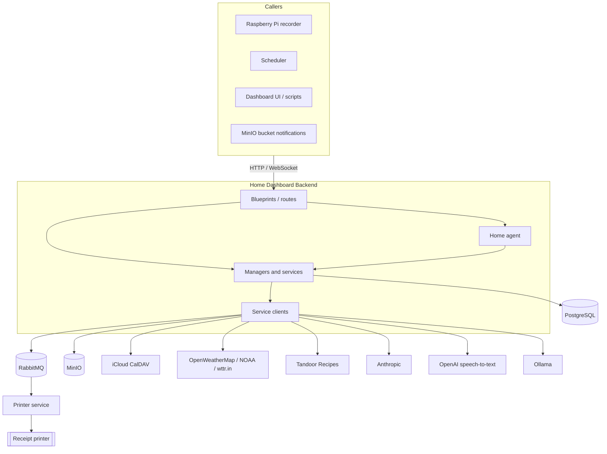
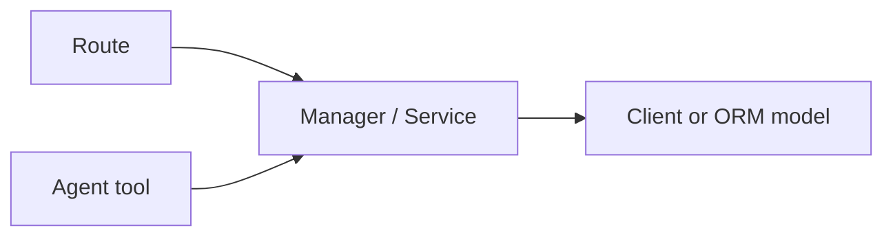
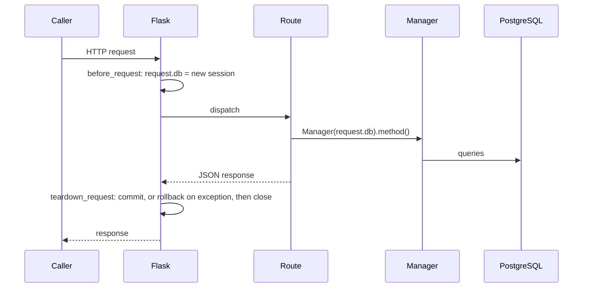
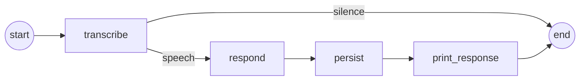
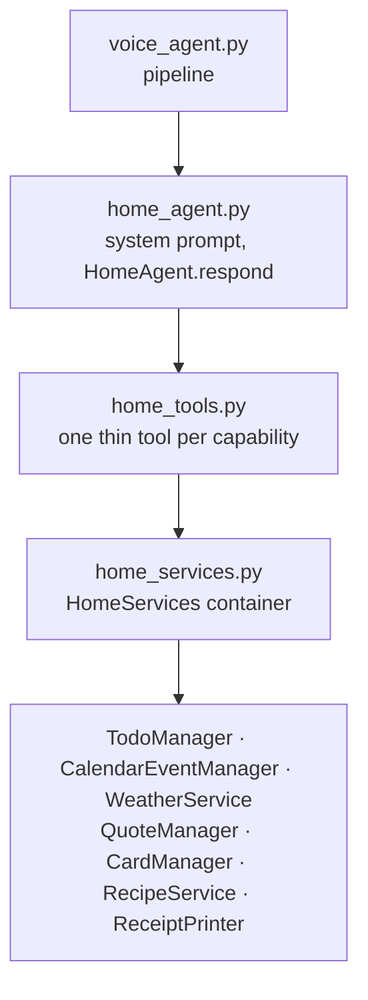

# Architecture

## System context

The backend is a Flask API. It owns the data and the logic; everything
physical or scheduled lives outside it.



| Outside piece | Role | Talks to the backend via |
|---|---|---|
| Raspberry Pi recorder | Records voice requests | `POST /ai/audio/upload`, or uploads to MinIO |
| Scheduler | Triggers the morning print and event notifications | `GET /tasks/print`, `POST /calendar/events/notify-upcoming` |
| Printer service | Consumes print jobs and drives the printer | RabbitMQ queues `text_print`, `stream_print`, `image_print` |
| MinIO | Stores recordings and rendered images; can notify on new objects | `POST /ai/audio/events` webhook |

None of these are in this repository.

## Code layout

```
app.py                      WSGI entry point (app:app)
dashboard/__init__.py       create_app(): config, logging, broker, DB session, blueprints
dashboard/src/
  db.py                     SQLAlchemy Base and session factory
  ai/                       /ai routes, voice pipeline, agents, AI clients
    agents/                 home agent, its tools and services, voice graph
    clients/                Claude, OpenAI transcription, Ollama
  audio/                    /audio routes and the /audio/ws WebSocket
  calendars/                /calendar routes, CalDAV sync, todos
  data/                     /data device events
  learning/                 /learning: cards, topics, subjects, checklists,
                            routines, reminders, quizzes, quiz prints
  prints/                   /prints routes, receipt building, print delivery
  quotes/                   /quotes routes and rotation logic
  recipes/                  /recipes routes, Tandoor client
  tasks/                    /tasks: daily receipt and math worksheets
  weather/                  /weather routes and weather clients
  message_broker/           RabbitMQ client
  storage/                  MinIO client
  utils/                    logging, helpers, decorators
alembic/                    database migrations
tests/                      mirrors dashboard/src
```

Ten blueprints are registered in `register_blueprints()`: `weather`,
`calendar`, `tasks`, `ai`, `audio`, `learning`, `prints`, `data`, `quotes`,
`recipes`. The `learning` blueprint nests eight sub-blueprints under
`/learning`.

## Layers



- **Routes** (`<module>/__init__.py`, `learning/routes/`) parse the request,
  call a manager and shape the JSON response.
- **Managers and services** hold the business rules. A manager takes a
  database session (`TodoManager(db)`, `QuoteManager(db)`, `CardManager(db)`,
  …). Services wrap an external client (`WeatherService`, `RecipeService`).
- **Clients** wrap one external system each and are chosen through factory
  functions with lazy imports, so a backend's dependencies load only when it
  is used:

  | Factory | Sources |
  |---|---|
  | `get_weather_client(source)` | `noaa`, `wttr`, `open-weather` |
  | `get_calendar_client(source)` | `ical` (iCloud CalDAV) |
  | `get_storage_client(source)` | `minio` |
  | `get_message_broker_client(source)` | `RabbitMQ` |
  | `get_ai_client(source)` | `claude`, `openai`, `ollama` |

- **Agent tools** are a second entry point into the same managers. A tool
  calls one manager method and formats the result, so the HTTP API and the
  voice assistant share one set of rules.

## Request lifecycle

`create_app()` runs once per worker:

1. `setup_config` copies environment variables into `app.config`.
2. `setup_logging` configures stdout logging.
3. `setup_message_broker` opens the RabbitMQ connection and stores the client
   in `app.config["message_broker_client"]`. **RabbitMQ must be reachable or
   the app does not start.**
4. `configure_db` installs the per-request session hooks.
5. `register_blueprints` registers routes and the WebSocket.

For each request:



Routes never create sessions. They use `request.db`, and the teardown hook
commits on success and rolls back if the view raised.

## Printing

Nothing in the backend talks to the printer. A print is a JSON message
published to RabbitMQ on the default exchange:

| Queue | Message | Used for |
|---|---|---|
| `text_print` | A receipt: `{"title": ..., "<section title>": [lines]}` | Almost everything |
| `stream_print` | `{"type": "line", "text": ...}` or `{"type": "cut"}` | Line-by-line printing without cutting |
| `image_print` | `{"instructions": [...]}` (text, images, QR codes) | Math worksheets |

Building a receipt and delivering it are separate:

- `ReceiptFormatter` collects `Section` objects and `build()`s the receipt
  dict.
- `PrintManager` knows what each kind of receipt looks like (todo, reminder,
  checklist, event, quiz, voice reply, ingredient list).
- `ReceiptPrinter` publishes a built receipt to `text_print`.
- `prints/orchestration.py` builds the receipts that need several managers at
  once — the daily receipt and pop quizzes.

Formats are described in the [printing guide](guides/printing.md).

## The daily receipt

`GET /tasks/print` calls `orchestration.print_tasks()`, which adds sections in
this order and skips any that are empty:


Building it has side effects: it syncs today's calendar from CalDAV into the
database, advances the quote rotation, and records that interval routines,
reminders, todos and the study subject were shown today. See the
[daily receipt guide](guides/daily-receipt.md).

## The voice pipeline

A voice request runs through a small LangGraph `StateGraph`
(`ai/agents/voice_agent.py`):



| Node | What it does |
|---|---|
| `transcribe` | Sends the audio to OpenAI speech-to-text. |
| `respond` | Runs the home agent on the transcription. |
| `persist` | Saves filename, transcription and reply to `voice_queries`. |
| `print_response` | Prints the reply, unless the agent already printed something or was told not to print. |

A silent recording ends after `transcribe`, so the agent is never called and
nothing is saved or printed.

### The home agent



`HomeAgent` wraps LangChain's `create_agent` (a LangGraph tool-calling loop)
over `ChatAnthropic`. Its tools:

| Tool | Backend call |
|---|---|
| `list_todos`, `add_todo`, `complete_todo` | `TodoManager` |
| `get_calendar_events` | `CalendarEventManager.get_synced_events_for_date` |
| `get_weather` | `WeatherService.get_weather` |
| `search_quotes`, `add_quote`, `pin_quote` | `QuoteManager` |
| `create_flashcard` | `CardManager.add_card` |
| `search_recipes`, `get_recipe`, `print_recipe_ingredients` | `RecipeService` |
| `print_text` | `ReceiptPrinter.print_text` |
| `skip_reply_print` | none — a signal to the pipeline |

After each run `HomeAgent.used_tools` holds the names of the tools that were
called. The pipeline reads it to decide whether to print the reply:

- a tool in `PRINTING_TOOLS` (`print_text`, `print_recipe_ingredients`) was
  used → the request already produced paper, so the reply is not printed too;
- `skip_reply_print` was used → the user asked for no printout;
- otherwise → the reply is printed with a timestamp title.

Three entry points reach the agent:

| Endpoint | Input | Prints the reply |
|---|---|---|
| `POST /ai/audio/upload` | Audio file from the Pi | Yes |
| `POST /ai/audio/events` | MinIO notification about a stored recording | Yes |
| `POST /ai/agent` | Text | No |

## Calendar sync

iCloud is the source of truth; the `calendar_events` table is a local copy.
`CalendarEventManager.sync_events()` fetches a time range over CalDAV and
inserts new events, updates changed ones and deletes those that are gone.

The copy exists so the backend can remember things about an event — mainly
`notified_at`, which is how `POST /calendar/events/notify-upcoming` prints each
upcoming event once however often it is polled.

## Deployment shape

The `Dockerfile` builds a Python 3.12 image that runs
`gunicorn --bind 0.0.0.0:8050 --timeout 180 app:app`. The 180-second timeout is
deliberate: a voice request is a transcription plus an agent loop with several
model calls and can take over a minute, far beyond Gunicorn's 30-second
default.

Releases are built and deployed by two Jenkins pipelines; see
[development.md](development.md#releases-and-deployment).
