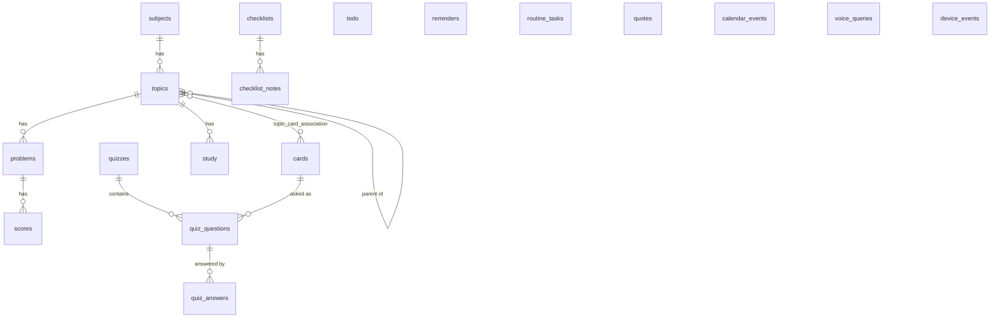

# Data model

PostgreSQL 16, accessed through SQLAlchemy 2. Models inherit from `Base` in
`dashboard/src/db.py` and live in each module's `models/` package. The schema
is managed with Alembic (`alembic/versions/`); see
[development.md](development.md#database-migrations).

## Overview

The tables in the bottom row stand alone.

## Planning

### `todo`

One-off things to do. Printed on the daily receipt while `active`.

| Column | Notes |
|---|---|
| `title` | |
| `active` | `false` once completed |
| `last_shown_date` | Last day it appeared on the daily receipt |

### `reminders`

Standing notes printed every day until switched off. Same shape as `todo`.

### `routine_tasks`

Recurring chores.

| Column | Notes |
|---|---|
| `title` | |
| `schedule_pattern` | `day_of_week day_of_month month`, e.g. `1-5 * *` |
| `interval_days` | Alternative to a pattern: show every N days |
| `last_shown_date` | Drives `interval_days` |
| `priority` | Lower prints first |
| `active` | |

### `checklists` and `checklist_notes`

A checklist is a title plus `items`, a PostgreSQL text array. Notes are extra
lines printed under the items; each has a `position` so they can be reordered.

### `calendar_events`

A local copy of iCloud calendar events, refreshed by sync.

| Column | Notes |
|---|---|
| `uid` | CalDAV UID, unique — the key used to match events on sync |
| `calendar` | Name of the source calendar |
| `summary`, `start_time`, `end_time`, `recurring` | |
| `last_synced` | |
| `notified_at` | Set when the event was printed as "upcoming", so it prints once |

## Learning

### `subjects`

Things being studied. A subject with `study_active` resurfaces on the daily
receipt on a spaced-repetition schedule.

| Column | Notes |
|---|---|
| `name` | Unique |
| `study_active` | Include in the study rotation |
| `always_show` | Ignore the interval and show every day |
| `times_shown` | Number of times shown; decides the next interval |
| `last_shown_date` | |

### `topics`

A tree of topics under a subject (`subject_id`, optional `parent_topic_id`).

### `cards`

Flashcards: `title` is the question, `content` the answer.

| Column | Notes |
|---|---|
| `reviewed`, `reviewed_date` | Set when a person has checked the card. Only reviewed cards are quizzed |
| `grokked` | Learned — the card leaves the quiz pool |
| `knowledge_level` | 0 unknown, 1 learning, 2 familiar, 3 known, 4 mastered |
| `consecutive_correct` | Correct answers in a row; 3 means mastered |

Cards link to topics through `topic_card_association`.

### `quizzes`, `quiz_questions`, `quiz_answers`

A quiz is one printed pop quiz. `quiz_questions` records which cards were on it
and in what `position`. `quiz_answers` records a score per question: 0
incorrect, 1 partial, 2 correct. A question can be answered more than once.

### `problems`, `scores`, `study`

Tables for generated practice problems and study tracking. `problems` stores
the problem JSON with a unique SHA-256 `hash`; `scores` holds results;
`study` tracks a status per topic (Not Started, In Progress, Complete, Paused,
Archived).

## Everything else

### `quotes`

| Column | Notes |
|---|---|
| `text`, `author` | |
| `active` | Inactive quotes are never drawn |
| `pinned`, `pinned_date` | At most one quote is pinned |
| `times_shown`, `last_shown_date` | Drive the rotation |

### `voice_queries`

One row per answered voice request: the recording's `filename` in MinIO, the
`transcription`, the agent's `response` and `created_at`. Also used to skip
recordings that were already processed.

### `device_events`

A log of `device_id` + `recorded_at`, written by `POST /data/event`. Lets a
button or sensor record that something happened.
