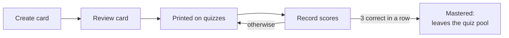

# Flashcards and quizzes

Learning on paper: write flashcards, get them printed as pop quizzes, grade
yourself, and record the scores so the system knows what you have learned.



## Flashcards

A card has a `title` (the question) and `content` (the answer).

### Create

```bash
curl -X POST http://localhost:8050/learning/cards \
  -H 'Content-Type: application/json' \
  -d '{"title": "What is the powerhouse of the cell?", "content": "The mitochondrion"}'
```

Several at once — the body is a list:

```bash
curl -X POST http://localhost:8050/learning/cards/batch \
  -H 'Content-Type: application/json' \
  -d '[
        {"title": "Capital of Australia?", "content": "Canberra"},
        {"title": "Boiling point of water at sea level?", "content": "100 C"}
      ]'
```

You can also ask the [voice assistant](voice-assistant.md): "make three
flashcards about photosynthesis."

### Review

**A new card is not quizzed until it has been reviewed.** This is the step
where you check a card — especially one written by the assistant — before it
starts showing up on paper.

Find the cards waiting for review:

```bash
curl 'http://localhost:8050/learning/cards?reviewed=false'
```

Any update marks a card as reviewed. Fix the text if needed, or send it back
unchanged:

```bash
curl -X PUT http://localhost:8050/learning/cards/12 \
  -H 'Content-Type: application/json' \
  -d '{"content": "The mitochondrion (plural: mitochondria)"}'
```

To file a card under topics, include `topic_ids`. The list replaces the card's
current topics, and an empty list clears them:

```bash
curl -X PUT http://localhost:8050/learning/cards/12 \
  -H 'Content-Type: application/json' \
  -d '{"topic_ids": [3, 4]}'
```

### Stop quizzing a card

```bash
curl -X PUT http://localhost:8050/learning/cards/12 \
  -H 'Content-Type: application/json' \
  -d '{"grokked": true}'
```

Or delete it: `curl -X DELETE http://localhost:8050/learning/cards/12`.

## Quizzes

A quiz is drawn from the **quiz pool**: cards that are reviewed and not yet
mastered. The questions in that pool are also listed at the bottom of each
[daily receipt](daily-receipt.md).

### Print a pop quiz

```bash
curl -X POST http://localhost:8050/learning/print/pop-quiz \
  -H 'Content-Type: application/json' \
  -d '{"num_questions": 5}'
```

```json
{
  "status": "ok",
  "quiz_id": 42,
  "question_count": 5,
  "message": "Printed pop quiz with 5 questions"
}
```

| Field | |
|---|---|
| `num_questions` | How many questions, picked at random. Omit for the whole pool |
| `include_answers` | Also print an answer sheet. Default `true` |

Two receipts come out: the quiz, with three checkboxes under each question for
grading yourself, and then the answer sheet. The quiz number is printed in the
title — keep it, you need it to record scores. With an empty pool nothing is
printed and `quiz_id` is `null`.

To print everything with no options, send an empty JSON object: `-d '{}'`.

### Record scores

First look up the quiz to get its question ids:

```bash
curl http://localhost:8050/learning/quiz/42
```

```json
{
  "id": 42,
  "created_date": "2026-10-13T07:30:00",
  "questions": [
    {
      "id": 101,
      "position": 0,
      "card": {"id": 12, "title": "What is the powerhouse of the cell?", "content": "..."},
      "answers": []
    }
  ]
}
```

Then send the scores. Use the question `id`, not the card id.

| Score | Meaning |
|---|---|
| `0` | Incorrect |
| `1` | Partially correct |
| `2` | Correct |

```bash
# the whole quiz at once
curl -X POST http://localhost:8050/learning/quiz/42/answers \
  -H 'Content-Type: application/json' \
  -d '{"answers": [
        {"question_id": 101, "score": 2},
        {"question_id": 102, "score": 1},
        {"question_id": 103, "score": 0}
      ]}'

# or one question
curl -X POST http://localhost:8050/learning/quiz/42/question/101/answer \
  -H 'Content-Type: application/json' \
  -d '{"score": 2}'
```

The bulk call validates every answer first and records none if one is invalid.

### What a score does

Each score updates the card's knowledge level:

| Result | Effect on the card |
|---|---|
| Correct | Counts towards a streak. One correct → at least *familiar*; two in a row → *known*; three in a row → *mastered* |
| Partial | Streak resets. Level becomes at least *learning* and at most *familiar* |
| Incorrect | Streak resets. Level drops to *learning* |

A mastered card is marked `grokked` and leaves the quiz pool.

### Reprint

```bash
# the same questions again, shuffled, with answers
curl -X POST http://localhost:8050/learning/print/quiz/42 \
  -H 'Content-Type: application/json' -d '{}'

# keep the original order, no answer sheet
curl -X POST http://localhost:8050/learning/print/quiz/42 \
  -H 'Content-Type: application/json' \
  -d '{"randomize": false, "include_answers": false}'

# just the answer sheet
curl -X POST http://localhost:8050/learning/print/quiz/42/answers
```

### List past quizzes

```bash
curl http://localhost:8050/learning/quiz
# [{"id": 42, "created_date": "...", "question_count": 5}, ...]
```

## Study subjects

Separate from flashcards: a subject is a broad thing you want to keep coming
back to ("Spanish", "Linear algebra"). When a subject is in the study
rotation, the daily receipt prints "Study: <name>" on the days it is due —
often at first, then less and less.

### Set one up

```bash
curl -X POST http://localhost:8050/learning/subjects \
  -H 'Content-Type: application/json' \
  -d '{"name": "Spanish"}'

# add it to the rotation
curl -X POST http://localhost:8050/learning/subjects/1/study/enable
```

### How often it appears

The gap between appearances grows with the number of times a subject has been
shown:

| Times shown so far | Days until it is due again |
|---|---|
| 0–4 | 1 |
| 5–7 | 2 |
| 8–12 | 3 |
| 13–16 | 5 |
| 17–20 | 8 |
| 21–24 | 13 |
| 25 or more | 21 |

The daily receipt shows **one** subject per day. When several are due, the one
shown longest ago goes first, so they take turns.

To make a subject appear every day regardless:

```bash
curl -X PUT http://localhost:8050/learning/subjects/1 \
  -H 'Content-Type: application/json' \
  -d '{"always_show": true}'
```

### Check and manage

```bash
curl http://localhost:8050/learning/subjects/study/today       # due today
curl 'http://localhost:8050/learning/subjects?study_active=true'
curl http://localhost:8050/learning/subjects

curl -X POST http://localhost:8050/learning/subjects/1/study/disable
```

## Topics

Topics organise a subject into a tree and can be attached to cards.

```bash
curl -X POST http://localhost:8050/learning/topics \
  -H 'Content-Type: application/json' \
  -d '{"name": "Verbs", "subject_id": 1}'

# a sub-topic
curl -X POST http://localhost:8050/learning/topics \
  -H 'Content-Type: application/json' \
  -d '{"name": "Irregular verbs", "subject_id": 1, "parent_topic_id": 3}'

curl http://localhost:8050/learning/topics
```
