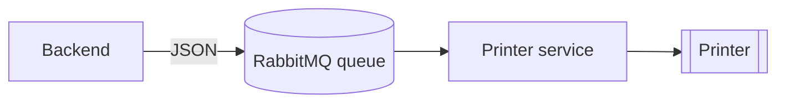

# Printing

Most printing happens as part of a feature — the daily receipt, a quiz, a
checklist. This guide covers printing arbitrary text, and what actually
travels to the printer.

## Print some text

```bash
curl -X POST http://localhost:8050/prints/ \
  -H 'Content-Type: application/json' \
  -d '{"text": ["Gone to the shop", "Back at 3"]}'
# {"status": "complete"}
```

`text` is a **list of lines**. The receipt has no title and is cut when it is
done. Note the trailing slash in `/prints/`.

The backend sends the lines as they are, without wrapping them, so keep each
within the paper width (48 characters on 80mm paper).

## Print line by line

`POST /prints/stream` prints without cutting, so output can build up over time
— a running log, for example — and be cut when you decide.

```bash
# print a line
curl -X POST http://localhost:8050/prints/stream \
  -H 'Content-Type: application/json' \
  -d '{"text": "Laundry started"}'

# cut the paper
curl -X POST http://localhost:8050/prints/stream \
  -H 'Content-Type: application/json' \
  -d '{"cut": true}'
```

Several messages in one call, with a pause between them:

```bash
curl -X POST http://localhost:8050/prints/stream \
  -H 'Content-Type: application/json' \
  -d '{
        "messages": [
          {"text": "Line 1"},
          {"text": "Line 2"},
          {"cut": true}
        ],
        "delay": 2
      }'
# {"status": "sent", "count": 3}
```

`delay` is in seconds. The request stays open until every message has been
sent.

## Everything that prints

| Call | Prints |
|---|---|
| `GET /tasks/print` | The [daily receipt](daily-receipt.md) |
| `POST /ai/audio/upload`, `POST /ai/audio/events` | A [voice reply](voice-assistant.md#when-the-reply-is-printed) |
| `PUT /calendar/todo/<id>` with `"active": false` | The completed todo |
| `POST /calendar/todo/<id>/print` | A todo |
| `POST /calendar/events/print-next` | The next timed event |
| `POST /calendar/events/notify-upcoming` | Events starting soon |
| `POST /learning/reminder/<id>/print` | A reminder |
| `POST /learning/checklists/<id>/print` | A checklist |
| `POST /learning/print/pop-quiz` | A quiz and its answers |
| `POST /learning/print/quiz/<id>` | A quiz again |
| `POST /learning/print/quiz/<id>/answers` | An answer sheet |
| `POST /recipes/<id>/print-ingredients` | An ingredient checklist |
| `GET /tasks/math-problems` | A math worksheet |
| `POST /prints/`, `POST /prints/stream` | Your text |

## How a print reaches the printer

The backend does not talk to the printer. It publishes a JSON message to
RabbitMQ and returns; a separate printer service consumes the queue and drives
the hardware.



Consequences worth knowing:

- A successful response means the job was **queued**, not printed.
- If the printer is off or out of paper, the backend does not find out.
- Queued jobs are lost if RabbitMQ restarts.

## Message formats

This is the contract with the printer service. Messages go to the default
exchange with the queue name as the routing key; queues are non-durable.

### `text_print` — receipts

A JSON object. The `title` key comes first; every other key is a section
title mapped to its lines, in print order.

```json
{
  "title": "  Oct 13, 2026  ",
  "": ["", "      \"A centred quote.\"", ""],
  "Weather": ["Current:               18C / 64F"],
  " To Do ": ["[ ] Buy milk", "[ ] Call the dentist"]
}
```

- Key order matters: it is the order of the sections on paper.
- A section titled `""` has no heading.
- `title` may be `""` for a receipt with no title (free text).
- Leading spaces in a line are intentional — they centre the text — and must
  be preserved.
- Bullets and checkboxes are already part of each line.

### `stream_print` — line by line

```json
{"type": "line", "text": "Laundry started\n\n\n\n\n\n\n\n"}
```

```json
{"type": "cut"}
```

The trailing newlines feed the line clear of the print head.

### `image_print` — worksheets

A list of printer instructions executed in order. Used for
[math worksheets](other-endpoints.md#math-worksheets).

```json
{
  "instructions": [
    {"set": {"invert": true}},
    {"textln": "Quadratic equations"},
    {"set": {"invert": false}},
    {"ln": 2},
    {"image": {"img_source": "<url of a rendered formula>", "impl": "bitImageRaster", "center": false}},
    {"qr": {"content": "http://...", "size": 3}}
  ]
}
```

| Instruction | Meaning |
|---|---|
| `text`, `textln` | Print text, without or with a line break. `textln` lines are pre-wrapped to the paper width |
| `ln` | Feed N lines |
| `set` | Change text style: `align`, `font`, `bold`, `underline`, `invert`, sizes |
| `image` | Print the image at `img_source` (a MinIO URL) |
| `qr`, `barcode` | Print a QR code or barcode |
| `block_text` | Print a block of text with optional `font` and `columns` |

The instruction names and their options follow the printer methods of
[python-escpos](https://python-escpos.readthedocs.io/).
